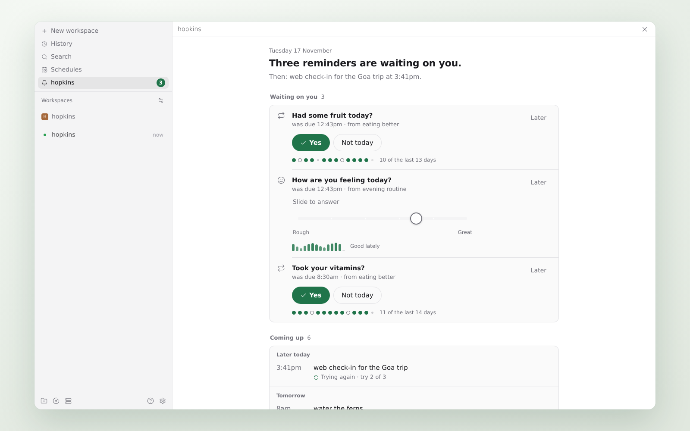

# hopkins

**A Paseo plugin that remembers what you asked to be reminded of, and brings it back at the right moment, in one conversation you can reply to.**



Say *"remind me to call Ma on Sunday at 10"* to any agent in [Paseo](https://paseo.sh). On Sunday at 10 a conversation called **hopkins** says *"Call Ma. You'd said Sunday morning."*, and your phone buzzes. Answer right there: *"done"*, *"snooze an hour"*, *"move it to 6"*.

It can also get things **done** at a time: *"today at 8pm, do my web check-in, and make sure the passport number and date of birth match"*. At 8pm hopkins starts an agent with your usual setup to do it, and tells you how it went. A repeating reminder can be a **check-in** that asks *"Had some fruit today?"* with **Yes** and **Not today**, or how you feel with a mood slider, and keeps every answer. And a reminder can **stop by itself**: *"remind me to go to bed at 11 until I'm waking up by 7:30"* checks your sleep data each morning and stops once it has held a week.

hopkins is built around a few rules:

- **It asks once instead of guessing.** *"remind me to renew the passport"* gets *"Saturday at 11, or Monday at 9?"*. A date and a time make a reminder far more likely to work than a vague "later".
- **It never loses a reminder.** Reminders that fall due while Paseo is down arrive when it's back, marked late. A busy conversation is never interrupted. Two reminders in a row both buzz.
- **It speaks briefly, and rarely.** Each message leads with the point and fits in a phone notification. Important reminders ping once more if you haven't seen them; nothing else nags.
- **You can always see what it has scheduled.** A **Today** screen shows what's waiting on you, what's coming, and what was delivered and whether you saw it.

## How it works

```
any agent (Claude, Codex, OpenCode …)
  └─ hopkins tools: remind · reminders · change · close
hopkins plugin (inside the Paseo daemon)
  ├─ store       plain JSON in the daemon's data folder, written atomically
  ├─ scheduler   checks every 15 s; catches up after downtime
  ├─ tasks       starts an agent at the time you gave, follows it, reads its report
  ├─ conditions  a daily read-only check behind reminders that stop by themselves
  └─ delivery    writes the reminder into the hopkins conversation → Paseo pushes it
hopkins conversation   one agent that turns due reminders into short messages
                       and handles your replies
Today screen           one headline · what needs you · one timeline of reminders and tasks
                       · Noticed, reviewed one at a time; the sidebar badge counts what needs you
```

- **Every agent gets four tools:** `hopkins_remind`, `hopkins_reminders`, `hopkins_change_reminder` and `hopkins_close_reminder`. They work from personal and work agents alike. A folder you mark as work tags its reminders `work`.
  - They are served by a small MCP server hopkins runs on localhost. Each Claude, Codex or OpenCode session reaches it through a tiny stdio bridge added as the session opens. No secret goes on a command line, and open sessions keep working across plugin restarts.
  - Paseo's own tool injection is off by default, and turning it on would hand every agent Paseo's whole toolset. hopkins's server needs neither.
- **Reminder lifecycles run in code, not in the model.** That covers due times, repeats, snoozes and catch-up. The model only turns your words into a structured call, and a due reminder into a sentence.
- **Repeats keep their wall-clock time across daylight-saving changes.** They can be daily, weekly, every N weeks, monthly on a date, the first or last weekday of the month, or yearly, with an optional end date or count.
- **Paseo has no plugin API for custom push notifications.** So hopkins delivers by finishing a turn in its own conversation, which makes Paseo push "Agent finished" with the message. Before each delivery hopkins clears that conversation's unread flag, so every reminder pushes.

## Noticing, and your history

Some things never get said as "remind me". You tell an agent "I'll send the deck Friday", or a note says the CI key expires on 3 January. hopkins can find these:

- **As you go.** When a conversation goes quiet, hopkins reads what *you* typed since it last looked, plus the agent's last hand-off. A small model looks for open loops. This happens at most every half hour.
- **Your history, once.** "Look through history" on the Today screen reads Claude Code's past conversations and the memory notes it keeps. It finds open loops in each conversation, then reviews them all against your notes, which are the most current record of what is done. Finished and stale things are dropped.

Either way they land under **Noticed** on Today, each with where it came from and a suggested time. **Review** walks through them one at a time: **Remind me** at the suggested time, **Another time**, **Already done**, **Not needed** or **Skip**, and **Undo** takes the last one back. On a keyboard: Enter, T, D, X, S and U. Nothing becomes a reminder without your tap, and nothing you set aside is suggested again.

Noticing needs a model.

- It works with any Anthropic Messages endpoint. Haiku is plenty, and you choose the model in settings.
- The key and its endpoint live together on the daemon host, never in settings: every connected app can edit settings, and the key is only ever sent to the endpoint stored with it. Either put them in a file:

  ```sh
  printf '%s\n%s\n' "$YOUR_KEY" "https://api.anthropic.com" > "$PASEO_HOME/plugin-data/hopkins/llm-key"
  chmod 600 "$PASEO_HOME/plugin-data/hopkins/llm-key"
  ```

  or set `HOPKINS_LLM_API_KEY` (and optionally `HOPKINS_LLM_BASE_URL`) in the daemon's environment.

## Install

hopkins needs **Paseo 0.16.1 or later**.

```sh
paseo plugin add github:rounakdatta/hopkins
```

Then open **Settings → Plugins → hopkins** to set your time zone and work folders. On first start hopkins creates its conversation and says hello.

## Using it

| You say (to any agent) | hopkins does |
|---|---|
| remind me to water the ferns tomorrow at 9 | sets it; confirms "Reminder set: water the ferns — tomorrow 9am." |
| remind me to renew the passport | asks once: two or three concrete times |
| remind me about the standup notes every weekday at 9:30 | a repeating reminder |
| this is important, remind me to sign the lease at 5 | pings once more if unseen after 30 minutes |
| someday remind me to learn the guitar | keeps it on the list with no time |
| what reminders do I have this week? | lists them |
| move the passport one to Monday 6pm | reschedules it |
| today at 8pm, do my web check-in; check the passport number and date of birth on the ticket | at 8pm starts an agent to do it, then tells you it is done, that it did not work, or the one thing it needs from you |
| remind me to go to bed at 11 every night until I'm waking up by 7:30 | confirms the rule once ("I'll check your sleep data at 9am; it stops after 7 days in a row"), checks quietly each morning, and tells you when it stops |
| remind me to have some fruit every day at 1pm | a check-in: at 1pm it asks "Had some fruit today?" with **Yes** and **Not today**, and keeps every answer |
| check in on my mood every night at 9:30 | asks how you feel, with a slider that speaks in words (Rough, Low, Okay, Good, Great) |
| yes, had an apple / honestly pretty low today | records the answer to today's check-in |

When a reminder arrives, reply in the hopkins conversation with "done", "snooze 1h", "tomorrow 9" or "drop it". You can also use the buttons on the Today screen.

**Tasks.** The agent you ask writes a complete brief (it is the only thing the task's agent sees), and asks you first for anything it cannot find. At the time, a background agent works from that brief. It ends with a short report; without one, hopkins says "have a look" rather than "done". When it needs something only you have (a one-time code, a mismatch to decide), its question reaches you through hopkins, and you answer inside the task's run (Today → Tasks → Answer in the run). A task due while hopkins was offline for longer than the grace period runs late only when that still makes sense (see below).

**Check-ins.** A repeating reminder can ask: whether you did it (a habit), or how you feel (a mood). The question arrives in the hopkins conversation with a card under it: one tap for Yes or Not today, or a drag on the mood slider, and it is recorded. You can also just say it. hopkins keeps one answer per day it was due. Answer early (you had the fruit at 11), and today's is skipped. Today shows every check-in under **Rhythms**: the last two weeks as dots (filled for yes, a ring for not today, faint for no answer) or as mood bars, with an honest count of only the days it was due. Not today is never shown as a fault.

**Tasks that fail.** hopkins says what happened, and tries again when that could work, at a time chosen from why it failed. The agent's own advice comes first ("the site is down: in 20 minutes"; "the window opens at 10:45"; "only you can fix this: no"). Then a small model weighs the failure, and finally a plain rule. There are at most three tries; a run that may still be going, or one waiting for your answer, is never retried; and nothing runs after a deadline you gave. A task due while hopkins was offline runs late only before its deadline, or when the model judges a late run harmless; otherwise it waits for "run it now".

**Reminders that stop by themselves.** The rule is made concrete when you set it: what to look at, when each day, and how many days in a row. Each day's check is read-only and answers yes, no or "could not tell"; a day it could not tell neither breaks nor extends the streak, and a second check on the same day replaces the first. You hear about it when it stops, or if it could not check for three days running; never on an ordinary day.

## Settings

| Setting | Default | |
|---|---|---|
| Time zone | the host's | IANA name, e.g. `Asia/Kolkata` |
| Work folders | `~/work` | agents under these folders tag reminders `work` |
| Morning / evening | 09:00 / 19:00 | used for "tomorrow" (no time), "morning", "tonight" |
| Clock | 12h | how times are written |
| Re-ping important after | 30 min | at most once |
| Conversation model | `claude/claude-sonnet-5-5` | the voice of hopkins |
| Task model, mode, thinking | `claude`, your default mode, the provider's default | the agents that do tasks |
| Personal folder | the asking conversation's folder | where personal tasks run (your files, notes and memory); work tasks run in the first work folder |
| Task grace / timeout | 180 min / 90 min | how late a task may still start on its own; how long it may run |
| Check model | the task model | the daily checks behind "until" reminders (a lighter model is plenty) |
| Paused | off | hold deliveries; they arrive when resumed |

## Privacy

- **Reminders stay on your machine,** in `$PASEO_HOME/plugin-data/hopkins/`: files `0600`, folder `0700`. Text leaves the machine in two places only:
  - the hopkins conversation's model sees the reminders it writes about;
  - with noticing on, the model you configure sees what you typed in the conversations it reads.
- **Logs never contain reminder text.** Paseo copies plugin output into the daemon log, so hopkins logs only ids, counts and states. The event journal records transitions, not content.
- **Tasks act for you, and only when you asked.** A task's agent runs at the time you gave, in your usual setup and permission mode, from the brief written when you asked. It is told to stop and ask before anything that costs money, needs a code, or does not match, and hopkins never reports a task done unless its agent said so. Checks behind "until" reminders are read-only.
- **The hopkins conversation runs in a normal permission mode.** Only its own reminder tools are pre-approved. Reminder text and titles are treated as data, so even a planted instruction would have to ask before touching a shell or a file.

## Development

```sh
npm install
npm run check      # type check + tests
```

- **Unit tests** cover the parts that must be exactly right:
  - time zones and daylight saving
  - repeat rules
  - parsing "when"
  - the store's crash safety
  - the delivery state machine, against a fake conversation that can be busy, fail, or go unread
- **End-to-end tests** run against a separate, throwaway Paseo daemon. They never touch your real one. See [docs/testing.md](docs/testing.md).

## License

MIT
